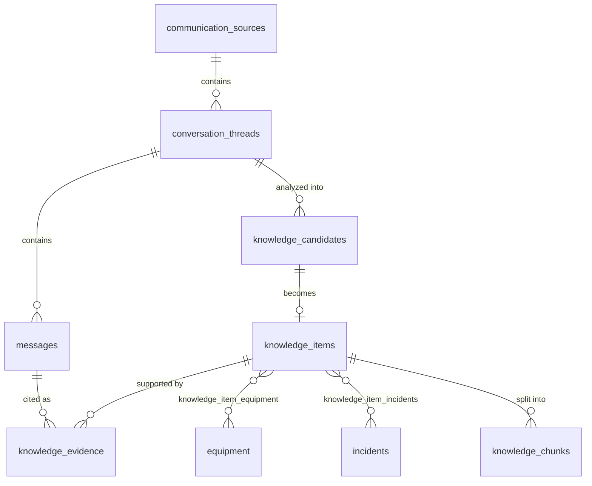

# Elisa Echo – Architecture

This document describes how Elisa Echo automatically discovers operational knowledge in
engineers' everyday communication, and how the implemented foundation supports it.

> **Status:** Phases 1–4 are implemented: the app foundation, the PostgreSQL schema (section 4),
> automatic discovery with Gemini (sections 3.1–3.5 and 5) and embeddings with hybrid retrieval
> (sections 3.6–3.7) and evidence-backed guided troubleshooting (section 3.8).
> See [roadmap.md](roadmap.md).

## 1. The problem

Engineers share valuable troubleshooting knowledge in Slack, Microsoft Teams, email and similar
channels. That knowledge is rarely written down anywhere else, so it gets buried and is lost to the
next engineer who meets the same problem.

A typical example:

1. **Engineer A:** "The DHCP service on edge router ER-114 keeps dropping leases."
2. **Engineer B:** "We had that last month. Restarting just the DHCP service fixed it. Don't reboot the whole router."
3. **Engineer A:** "Restarted the service. Leases are coming back. That worked, thanks."

This thread contains a symptom, an affected device, a fix, a warning about the wrong fix, and a
confirmation that the fix worked. Nobody will document it.

**Elisa Echo's core feature is to find, structure and preserve this knowledge automatically.**
Engineers never have to submit, document or categorize anything.

## 2. Design principles

| Principle | What it means in practice |
| --- | --- |
| **Automatic discovery** | Knowledge is extracted from conversations engineers already have. There is no manual submission form. |
| **Evidence first** | Every knowledge item links back to the exact source messages. Recommendations show their evidence. |
| **Confidence is explicit** | The system separates ordinary chatter, unverified suggestions and confirmed resolutions, and never presents a suggestion as a proven fix. |
| **Authorized sources only** | Only channels that have been explicitly connected and authorized are ingested. |
| **Synthetic data first** | The demo uses synthetic conversations. No real Slack, Teams or email accounts are connected until that is explicitly decided. |
| **Simple stack** | One FastAPI backend, one React frontend, one PostgreSQL database with pgvector. No queues, brokers or extra services unless clearly needed. |

## 3. Discovery workflow

```mermaid
flowchart LR
    A[Communication sources<br/>synthetic Slack / Teams / email] --> B[Ingest messages]
    B --> C[Group into<br/>conversation threads]
    C --> D[Classify messages<br/>ordinary / suggestion / confirmed]
    D --> E[Extract structured knowledge<br/>Gemini]
    E --> F[Link to incidents,<br/>equipment, experts]
    F --> G[Embed + store<br/>PostgreSQL + pgvector]
    G --> H[Retrieve for a new incident<br/>vector + keyword + context]
    H --> I[Evidence-backed recommendation<br/>+ optional decision tree]
```



### 3.1 Ingest

Messages arrive from authorized communication sources. Each message is stored with its original
identity: source, channel, thread, author, timestamp and text. The original message is never
modified, so it can always be shown as evidence.

In the demo, a **simulated live feed** replays synthetic conversations into the same ingestion
path a real connector would use. Real connectors can be added later without changing anything
downstream.

### 3.2 Group into threads

Messages are grouped into conversations, using the source's native thread ID when it has one
(Slack threads, email `In-Reply-To` headers). Knowledge is extracted per thread, not per message,
because a fix and its confirmation are usually in different messages.

### 3.3 Classify

Each thread is analyzed to decide whether it contains operational knowledge, and how trustworthy
that knowledge is:

| Class | Meaning | Example |
| --- | --- | --- |
| **Ordinary** | No reusable operational knowledge | "Lunch at 12?" |
| **Unverified suggestion** | A proposed fix that nobody has confirmed | "Maybe try restarting the DHCP service?" |
| **Confirmed resolution** | A fix that someone reports actually worked | "Restarted the service, leases are back. That worked." |

Only threads with a suggestion or a confirmed resolution go on to extraction. The class is stored
with the knowledge item and is always visible to users.

### 3.4 Extract (Gemini)

Gemini turns a qualifying thread into a structured knowledge item, validated against a Pydantic
schema. Planned fields:

- **Problem / symptoms**: what was observed
- **Equipment**: device identifiers, types and services involved (for example `ER-114`, DHCP)
- **Troubleshooting steps**: ordered actions, including steps marked as *not recommended*
- **Outcome**: resolved, partially resolved or unresolved
- **Applicability conditions**: when the fix applies and when it does not
- **Status**: unverified suggestion or confirmed resolution
- **Contributors**: who suggested the fix and who confirmed it
- **Provenance**: the IDs of the exact source messages that support each field

Output that fails validation is rejected rather than stored half-parsed.

### 3.5 Link

Each new knowledge item is connected to existing records:

- **Equipment** mentioned in the conversation
- **Incidents** with matching symptoms
- **Other knowledge items** for the same problem, for example a second engineer's alternative fix
- **Experts** who contributed or confirmed

Links to equipment and incidents are created during extraction. Links between knowledge items
are created by **consolidation** (Phase 6B, `app/services/consolidation/`): after indexing, an
item is compared by Gemini with a bounded set of candidates (embedding similarity + shared
identifiers); the server validates evidence and condition values, stores one relationship per
pair and forms groups only from items strongly related to every member. Group summaries list
resolution paths with conditions, failed attempts, contradictions and missing information, and
are never approved knowledge. See the README section "Knowledge consolidation".

### 3.6 Embed and store

Knowledge items are embedded and stored in **Tiger Data PostgreSQL** with **pgvector**, next to
the relational data (sources, threads, messages, incidents, equipment and provenance). Keeping
vectors and relational data in one database makes it simple to filter by equipment or status and
then rank by similarity in a single query.

### 3.7 Retrieve

Implemented in `app/services/retrieval/` (Phase 4): the three signals below are retrieved
separately inside SQL (filters and source access applied there) and combined with Reciprocal
Rank Fusion, with exact identifiers weighted double. See the README section "Knowledge search".

When an engineer describes a new problem, retrieval combines three signals:

1. **Semantic vector search**: similar problems described in different words
2. **Keyword search**: exact identifiers, error codes and device names
3. **Context**: knowledge linked to the same equipment or related incidents

Confirmed resolutions rank above unverified suggestions.

### 3.7a Learn from reuse (Phase 6C)

Engineers' troubleshooting outcomes are stored as `troubleshooting_feedback`, linked to the
session, the guide step and the source knowledge item. It is a second evidence origin next to
conversation messages, always self-reported, aggregated per session, and fed back into
search (display only), new guides and knowledge group summaries. It never changes a
knowledge item's resolution or approval status.

### 3.8 Recommend and guide

Implemented in `app/services/guides/` (Phase 5): retrieval -> Gemini draft from retrieved
knowledge only -> validation (single start, acyclic, reachable, evidence on every technical
step, statuses derived from knowledge) -> stored guide; sessions record answers, observations
and outcomes as append-only steps. See the README section "Guided troubleshooting".

Results are shown as **evidence-backed recommendations**: each step links to the source messages,
the contributing experts and its status. For more complex problems, related knowledge can be
assembled into an **interactive troubleshooting decision tree** (React Flow). Alternative paths
from different experts are kept as separate branches rather than merged silently.

## 4. Database schema

Implemented in Phase 2 (`backend/app/models/`, migration `backend/alembic/versions/0001_initial_schema.py`).
All tables use UUID primary keys and `timestamptz` timestamps. Status columns are `VARCHAR`
with `CHECK` constraints (not PostgreSQL `ENUM` types), so new values only need a small migration.



| Table | Purpose | Key rules |
| --- | --- | --- |
| `communication_sources` | An authorized channel: `slack`, `teams` or `simulated` | Unique (`source_type`, `external_source_id`) |
| `conversation_threads` | A discussion; `processing_status` = `pending` / `processing` / `processed` / `failed` | Unique (`communication_source_id`, `external_thread_id`); `started_at` / `last_message_at` derived from messages |
| `messages` | Original, unmodified message text with author, `sent_at` and `source_url` permalink | Unique (`thread_id`, `external_message_id`); ordered by (`sent_at`, `external_message_id`); edits and deletions synced via `edited_at` / `deleted_at`, rows never removed |
| `knowledge_candidates` | Something the AI *thinks* is knowledge, possibly before a fix is confirmed. `detection_status` = `detected` / `incomplete` / `rejected` / `accepted`; raw model output in `extracted_data` (JSONB) | `confidence` between 0 and 1 |
| `knowledge_items` | Structured knowledge: problem, symptoms, root cause, resolution, attempted actions, applicability conditions (JSONB lists) | One item per candidate; see the two statuses below |
| `knowledge_evidence` | Links an item to the **exact messages** that support it, with `evidence_type` = `problem_report` / `attempted_fix` / `suggested_solution` / `confirmed_resolution` / `applicability_condition` | Message FK is `RESTRICT`: a cited message cannot be deleted |
| `equipment` | Devices and services, e.g. `S42-RTR-01` | Unique `equipment_identifier` |
| `incidents` | Problem occurrences with status and severity | Unique `incident_number` |
| `knowledge_item_equipment`, `knowledge_item_incidents` | Many-to-many links | Composite primary keys |
| `knowledge_chunks` | Searchable text pieces of an item with an `embedding vector(768)` | Unique (`knowledge_item_id`, `chunk_index`); HNSW index with cosine distance |

### Two independent statuses on knowledge items

- `resolution_status`: what the **conversation** showed: `unknown`, `suggested` or
  `confirmed_in_conversation`.
- `approval_status`: what an **expert** decided: `unreviewed` (default), `approved` or `rejected`.

A fix confirmed in chat is still `unreviewed`. It never becomes an approved operational procedure
automatically.

### Embeddings

`EMBEDDING_DIMENSION = 768` (`backend/app/models/knowledge.py`). Phase 4 must request exactly this
size from the embedding model (for Gemini, `output_dimensionality=768`) for both stored chunks and
search queries. Changing it needs a migration and re-embedding. The column is nullable, so chunks
can exist before they are embedded. No embeddings are generated in Phase 2.

### Ingestion is idempotent

`backend/app/services/ingestion.py` upserts sources, threads and messages on their external IDs.
Delivering the same message twice updates it instead of creating a duplicate, which also lets edits
and deletions from the source be synchronized later. Nothing in the ingestion path deletes rows.

## 5. How conversation threads are processed (Phase 3, implemented)

Code: `app/services/discovery/` (analyzer, validation, prompt, engine) and `app/ai/` (Gemini
client and output schema). Differences from the original plan below: analysis runs in-process
(asyncio tasks with a per-thread debounce and a concurrency limit) instead of a separate
worker, and each thread keeps exactly one candidate that is updated in place. Irrelevant
threads get a `rejected` candidate as an audit record, so they are not re-analyzed unless
their messages change. The original plan:

Phase 2 leaves every ingested thread with `processing_status = 'pending'`. Phase 3 will:

1. **Feed:** a simulated live feed replays synthetic messages through `upsert_messages`, the same
   function the seed script uses. A new message on a processed thread sets it back to `pending`.
2. **Pick up work:** select `pending` threads, oldest `last_message_at` first, and mark them
   `processing` (`SELECT … FOR UPDATE SKIP LOCKED` if several workers ever run).
3. **Analyze:** send the thread's messages, in stored order and with their IDs, to Gemini and
   validate the response against a Pydantic schema.
4. **Store results** in one transaction:
   - a `knowledge_candidates` row for anything detected, with the raw output in `extracted_data`;
   - for usable candidates, a `knowledge_items` row with `resolution_status` set from the
     conversation and `approval_status = 'unreviewed'`;
   - `knowledge_evidence` rows pointing at the message IDs Gemini cited (IDs not in the thread are
     rejected);
   - links to `equipment` / `incidents`, created on their unique identifiers if new.
5. **Finish:** set the thread to `processed`, or `failed` so it can be retried.

Ordinary chatter (like the "Friday lunch" demo thread) produces no candidate, or a `rejected` one.

## 6. System components

```text
┌──────────────────────────┐   /api (Vite proxy)    ┌───────────────────────────┐
│ Frontend (React + Vite)  │ ─────────────────────► │ Backend (FastAPI)         │
│  Dashboard               │                        │  api/routes   HTTP layer  │
│  Live Discovery          │                        │  schemas      Pydantic    │
│  Search                  │                        │  services     logic       │
│  Troubleshoot            │                        │  models       SQLAlchemy  │
│  Knowledge Graph         │                        └──────┬──────────────┬─────┘
└──────────────────────────┘                               │              │
                                                           ▼              ▼
                                              Tiger Data PostgreSQL   Google Gemini
                                              + pgvector (Phase 2)    (planned, Phase 3)
```

- The **browser only talks to the FastAPI backend**. Gemini keys and database credentials stay on
  the backend and are never exposed through `VITE_` variables.
- Backend services are plain Python modules under `app/services/`, called from thin route
  handlers. Implemented: database health, sources, threads/messages, knowledge reads and
  idempotent ingestion. Planned: classification and extraction, linking, embedding, retrieval
  and decision-tree assembly.
- In Phase 3, the simulated live feed and extraction run inside the FastAPI process (for example
  as background tasks). No separate worker or message broker is planned unless the demo proves it
  necessary.

## 7. Application pages

| Route | Page | Purpose in the updated product |
| --- | --- | --- |
| `/` | Dashboard | Discovered knowledge, recent processing activity, system status |
| `/capture` | Communication Sources / Live Discovery | Incoming conversations and the knowledge automatically identified in them |
| `/search` | Search | Search automatically extracted operational knowledge |
| `/troubleshoot` | Troubleshoot | Evidence-backed interactive decision trees |
| `/knowledge` | Knowledge Base | Discovered knowledge, evidence and related knowledge |
| `/network` | Knowledge Network | Groups of related incidents: resolution paths, conditions, conflicts |

## 8. Security and privacy

- Only explicitly authorized sources are ingested. The demo uses synthetic conversations only.
- Secrets (`GEMINI_API_KEY`, `DATABASE_URL`) live only in `backend/.env`, which is git-ignored.
- Original messages are stored for provenance. Before connecting any real channel, retention,
  access control and handling of personal data must be agreed with Elisa.
